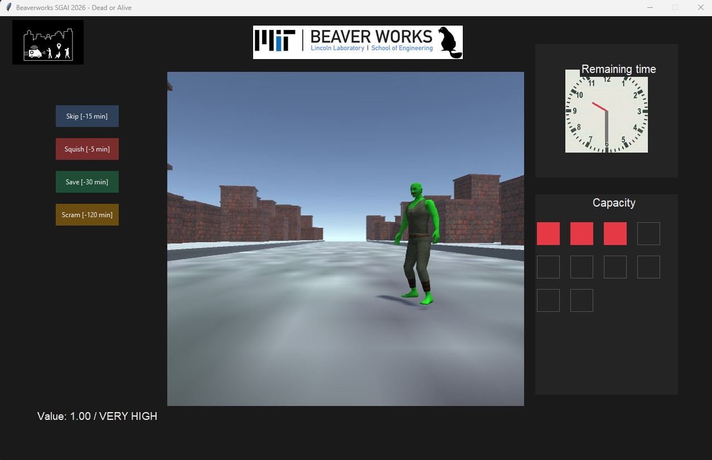

# BWSI SGAI 2026

  

A triage game where humanoids arrive and you decide who to save. Depending on the mode, you play solo, with AI assistance, or watch the AI play on its own — then dig into the data to understand what it's doing.

**First time here?** Start with [docs/setup.md](docs/setup.md) to get your environment running.



---

## Table of contents

- [Game modes](#game-modes)
- [Built with](#built-with)
- [What's in this repo](#whats-in-this-repo)
- [Module reference docs](#module-reference-docs)
- [Lecture modules](#lecture-modules)
- [Where to go next](#where-to-go-next)
- [License](#license)

---

## Game modes

Run any mode with the `bwsi-sgai` conda environment active:

```
python main.py -m <mode>
```

| Mode | What you do |
|---|---|
| `human` | You classify every humanoid and choose the action |
| `human_cnn` | The CNN tells you what it thinks — you make the final call |
| `human_rl` | The RL agent suggests an action — you decide whether to follow it |
| `human_cnn_rl` | CNN classifies + RL recommends, you decide |
| `machine` | CNN + RL play the game together, you watch |
| `auto` | RL plays with no GUI, results go straight to the terminal |

Start with `human` to learn the game, then try `human_cnn` or `human_rl` to see what the models are doing.

---

## Built with

- [Python 3.13](https://www.python.org/)
- [Tkinter](https://docs.python.org/3/library/tkinter.html) — GUI framework (included with Python)
- [PyTorch](https://pytorch.org/) — CNN training and inference
- [Gymnasium](https://gymnasium.farama.org/) — RL training environment

---

## What's in this repo

Everything visible in VS Code's file explorer is listed here (some only after running things).

### Source code

| Path | What it is |
|---|---|
| `main.py` | Entry point — reads command-line flags, picks a game mode, and starts the game |
| `gameplay/` | Core game rules — action costs, scoring, humanoid states, and constants |
| `game_interfaces/` | Game loop, dataset loading, RL training environment, and observation builder |
| `models/` | CNN classifier, RL recommender, rule-based recommender, and DQN agent |
| `ui/` | Everything you see on screen (Tkinter) |
| `training/` | Training scripts and notebooks for the CNN and RL agent |
| `data/` | 200 humanoid images and the metadata CSV |
| `tests/` | 293 automated tests (pytest) |

### Docs and lectures

| Path | What it is |
|---|---|
| `README.md` | This file |
| `docs/` | Student guide, setup instructions, architecture overview, troubleshooting, instructor guide, and cheat sheet |
| `lectures/` | 9 interactive RISE notebooks — one per major directory |

### Configuration

| Path | What it is |
|---|---|
| `environment.yml` | Conda environment spec — run `conda env create -f environment.yml` to set up |
| `requirements.txt` | Flat list of Python packages (same dependencies as `environment.yml`, without conda metadata) |
| `pyproject.toml` | Configuration for pytest — used during development |
| `.gitignore` | Tells git which files not to track (generated files, caches, machine-specific configs) |
| `.vscode/` | VS Code settings — includes `launch.json` with debug configurations for each game mode |

### Generated after running

These files don't exist in a fresh clone. They appear once you run the game or tests.

| Path | What it is |
|---|---|
| `log.csv` | Every game session appends a row here — humanoid decisions, actions taken, scores |
| `summary.csv` | One row per run — high-level stats for each session |

Delete either file to reset its history. OR, rename the log to keep it and generate a new one next time you play.

### Tool caches

Created automatically by development tools. Safe to delete; they'll be recreated the next time you run the relevant tool.

| Path | What it is |
|---|---|
| `__pycache__/` | Python's compiled bytecode cache — speeds up import times |
| `.pytest_cache/` | pytest's internal cache for test results and fixtures |
| `.coverage` | Binary data file written by pytest-cov when you run tests with coverage tracking |
| `coverage.xml` | Human-readable XML version of the coverage report |
| `.mypy_cache/` | mypy's internal cache for type-checking results |
| `.ruff_cache/` | Ruff linter's internal cache |

### Git and IDE

| Path | What it is |
|---|---|
| `.git/` | Git's internal database — version history, branches, remotes. Never modify this manually. |
| `.idea/` | JetBrains IDE (PyCharm) configuration — only appears if you've opened the project in PyCharm |

### Claude files

These files are gitignored.

| Path | What it is |
|---|---|
| `.claude/` | Claude Code configuration used by the instructors who built and maintain this project |
| `CLAUDE.md` | Instructions for Claude Code (an AI coding assistant) used during development |

---

## Module reference docs

Each module has a reference doc inside its own folder:

| Module | Reference |
|---|---|
| `gameplay/` | [gameplay/gameplay.md](gameplay/gameplay.md) |
| `game_interfaces/` | [game_interfaces/game_interfaces.md](game_interfaces/game_interfaces.md) |
| `models/` | [models/models.md](models/models.md) |
| `ui/` | [ui/ui.md](ui/ui.md) |
| `training/` | [training/training.md](training/training.md) |
| `data/` | [data/data.md](data/data.md) |
| `tests/` | [tests/tests.md](tests/tests.md) |
| `docs/` | [docs/docs.md](docs/docs.md) |

---

## Lecture modules

9 interactive RISE notebooks — one per major directory. Open in JupyterLab and press `Alt+R` to enter slideshow mode.

| Module | Topic | Notebook |
|---|---|---|
| 1 | Game Mechanics (`gameplay/`) | [lectures/module_01_game_mechanics.ipynb](lectures/module_01_game_mechanics.ipynb) |
| 2 | Data (`data/`) | [lectures/module_02_data.ipynb](lectures/module_02_data.ipynb) |
| 3 | User Interface (`ui/`) | [lectures/module_03_ui.ipynb](lectures/module_03_ui.ipynb) |
| 4 | Architecture & Wiring (`game_interfaces/` + `main.py`) | [lectures/module_04_architecture.ipynb](lectures/module_04_architecture.ipynb) |
| 5 | Perception — CNN (`models/` perception) | [lectures/module_05_perception.ipynb](lectures/module_05_perception.ipynb) |
| 6 | Decision — RL (`models/` decision) | [lectures/module_06_decision.ipynb](lectures/module_06_decision.ipynb) |
| 7 | Training (`training/`) | [lectures/module_07_training.ipynb](lectures/module_07_training.ipynb) |
| 8 | Tests (`tests/`) | [lectures/module_08_tests.ipynb](lectures/module_08_tests.ipynb) |
| 9 | AI-Assisted Exploration | [lectures/module_09_ai_exploration.ipynb](lectures/module_09_ai_exploration.ipynb) |

---

## Where to go next

- **Get oriented in the codebase** → [docs/architecture.md](docs/architecture.md)
- **Extend or modify the game** → [docs/student-README.md](docs/student-README.md)
- **Quick reference during experiments** → [docs/cheat-sheet.md](docs/cheat-sheet.md)
- **Something broke?** → [docs/troubleshooting.md](docs/troubleshooting.md)
- **Running the lectures?** → [docs/instructor-guide.md](docs/instructor-guide.md)
- **Windows-specific setup note** → [docs/windows-setup.md](docs/windows-setup.md)

---

## License

Released under the MIT License.
