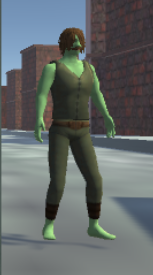
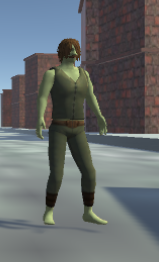
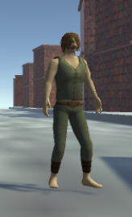
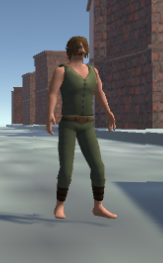
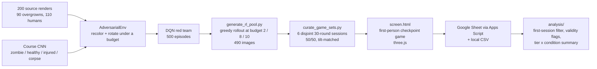

# Team Immortal: Adversarial Disguise vs. Human + AI Screening

   

A red-team reinforcement learning agent learns to disguise infected "overgrowns" as healthy humans under a fixed **malice budget**. A blue-team human screener, alone or with a CNN advisor, has to catch them. We built the agent, the game, and the study, then ran it on 28 people.

Final project for MIT Lincoln Laboratory's **Beaver Works Summer Institute 2026, Serious Games with AI**. Five-person team, four weeks.

<p align="center">
  
  
  
  
  
  <br>
  <sub>Left to right: a real human (the control), an unedited overgrown, and the same overgrown disguised by the agent at malice budget 2, 8, and 10. The last three are all overgrowns.</sub>
</p>

**Play the study build:** https://effervescent-kheer-bf8b11.netlify.app/ (data logging is switched off; nothing you do is recorded).

---

## Headline results

| Malice budget | Human + AI | Human alone | AI gain |
|---|---|---|---|
| 0 (real humans, control) | **84.0%** | 66.7% | +17 pts |
| 2 | **87.5%** | 87.8% | ~0 |
| 8 | **51.2%** | 20.8% | +30 pts |
| 10 | **38.1%** | 10.9% | +27 pts |
| All trials | **71.7%** (n=520) | 53.8% (n=294) | +18 pts |

- **Disguise works.** At the top budget, 89% of disguised overgrowns got past unassisted screeners. With the AI advisor, 62% still did.
- **The AI helped even when it was unsure.** The advisor was deliberately driven to its own decision boundary, so on the budget-10 images participants saw it was right only 59% of the time and said so (mean displayed confidence 69%). It was still right more often than not, and assisted players beat unassisted ones by 27 points there. They also took longer: 6.2 s vs. 3.2 s per decision.
- **Players followed the AI's clearest mistake on a human even though it flagged its own doubt.** An injured but living human that the CNN labeled "No Vital Signs Detected" at 50% confidence, shown as "AI LEANS: REJECT", was permitted by 89% of unassisted players and only 38% of assisted ones.
- **Participants knew the AI was fallible and followed it anyway.** They rated "AI can make mistakes" 6.7/7 and "there were times I thought the AI was wrong" 5.8/7, yet agreed with it on 74% of trials, against 55% for unassisted players making the same calls without seeing it. The CNN was right 87% of the time on what was shown, so following it was usually the correct call.

---

## Research question

> As the adversarial generator's malice budget increases, how do human classification accuracy and response time change, and does AI assistance reduce the decline?

**Independent variables:** malice budget (0 / 2 / 8 / 10 edits) and condition (human alone vs. human + AI, between subjects).
**Dependent variables:** per-trial accuracy and reaction time, plus agreement with the AI and a pre/post attitude survey in the AI condition.

---

## How it fits together



The course provided the triage game, the 4-class CNN, a DQN implementation, and the 200-image dataset. Everything from the adversarial environment onward is ours.

---

## The red team: an RL agent that learns to disguise

`game_interfaces/adversarial_env.py` is a Gymnasium environment. Each episode starts from a pristine overgrown render and a malice budget; each step spends one unit of budget on an edit.

### Two attack channels that fool different judges

| Edit | Fools | Why |
|---|---|---|
| **Recolor** (+0.25 per step, 4 steps to full) | the human | Repaints the figure's green skin to a brightness-matched skin tone. The CNN barely reacts: it never relied on color. |
| **Rotate** (±0.5° per step, capped at ±6°) | the CNN | A tilt of one to three degrees walks the classifier off the upright images it was trained on. A person reads it as a tilted camera. |

Color and geometry are orthogonal, so the two edits never interfere. Our first human-channel edit was a fog overlay. A pixel metric said the fog hid the green, but the figures were still visibly green and the fog also wrecked rotation's effect on the CNN. We threw it out and built the targeted recolor instead.

### Reward: aim for the decision boundary, not past it

The first reward maximized `P(healthy)`. The agent obliged: at the top tier **88% of images were confidently misclassified as healthy**. That is a useless trial. The human's eyes and the AI agree, so there is nothing to decide and nothing to learn about trust.

The final reward is a potential-based delta on a two-channel disguise score:

```
score  = 0.55 * hue_proxy  +  0.45 * tent
tent   = max(0, 1 - 2 * |P(healthy) - 0.45|)
reward = score_t - score_{t-1}        (STOP yields 0)
```

`hue_proxy` measures how much green is left on the figure's original skin pixels (1.0 = none). The tent peaks when the CNN sits just under its 0.5 verdict line, still saying "zombie" but only about 55% sure, and falls off on both sides. Overshooting into "confidently healthy" is a reward **loss**, so the agent learns to stop at the edge. Confidently-wrong images fell from 88% to **7% at the top tier**, roughly the CNN's own baseline error rate on untouched images.

Two alternatives were tried and rejected: rewarding raw uncertainty (`1 - max_prob`) gave too flat a signal far from the boundary and the agent under-rotated; targeting `P(zombie) = 0.5` with a wider budget of 16 let the agent sail past the boundary and doubled the dead cells.

### Constraints by masking, not penalties

Illegal moves are hidden from the agent with an action mask rather than punished with negative reward, so no budget is ever spent learning what is forbidden:

- over-budget and past-cap moves are masked,
- **rotation is masked until recolor is complete.** With free allocation the agent under-recolored about a third of figures, leaving green hands and feet a human would catch, which made the AI's opinion moot. The two-phase rule guarantees the human is fooled first, then the CNN is attacked with whatever budget remains.

The budget of 10 is itself a guardrail: four units fully recolor, six remain for rotation, which is enough to reach the boundary and not enough to overshoot it.

### Observation and training

Nine floats, all in [0, 1]: cumulative angle, cumulative recolor, budget left, the CNN's four class probabilities, and two **lookahead** features, the `P(healthy)` the CNN would report if the agent rotated one step clockwise or counter-clockwise. Rotation direction is image-specific, so without the lookahead the agent had no way to learn which way to tilt.

Rendering uses an accumulator: the environment stores the original image plus running edit totals and re-renders from the original every step, so edits never compound and the budget stays tied to real visual change. `hue_proxy` is measured on the recolor-only layer with a mask frozen on the original; the CNN sees the fully rotated image.

| | |
|---|---|
| Agent | DQN, MLP 9 → 128 → 128 → 4, Huber loss, Adam 1e-3, γ 0.95 |
| Exploration | ε 1.0 → 0.05 linearly over 250 episodes |
| Replay / target | buffer 2000, batch 32, hard target update every 10 episodes |
| Episodes | 500, seed 42, best-episode weights saved once ε < 0.5 |
| Cost per step | 3 CNN forward passes (current image + 2 lookaheads) |
| Monitoring | `training/action_tracker.py` reports budget share per channel so a collapse onto one channel is caught during training |

### What the tiers look like

The malice budget *is* the tier: the trained greedy policy runs once per overgrown at budget 2, 8, and 10 and is allowed to STOP on its own.

| Budget | Mean AI confidence shown | AI "uncertain" (< 70%) | AI confidently wrong | Recolor | Tilted |
|---|---|---|---|---|---|
| 2 | 96% | 3% | 10% | 0.50 | 0% |
| 8 | 80% | 40% | 0% | 1.00 | ~95% |
| 10 | 69% | 63% | 7% | 1.00 | ~95% |

Malice converts the advisor's confidence into doubt, not into confident errors.

---

## The blue team: the checkpoint game

`screen.html` is a first-person three.js scene. The player walks to a terminal, clicks it, and screens 30 subjects at 45 seconds each with three zoom levels and two buttons, PERMIT or REJECT. Real humans must be let through, including wounded ones; overgrowns must be turned away.

The condition is chosen once per browser and persisted, so a participant never sees both. In the **AI condition** every round shows a threat advisory derived only from the CNN's real output (its predicted class, whether its top two classes are within 0.25, and its confidence), an explicit "AI RECOMMENDS: PERMIT (97%)" line that softens to "AI LEANS" when the classifier is torn, and a confidence bar. Nothing the advisor says is invented: it reports four probabilities, so it never claims to have detected "asymmetrical features."

AI-condition players also answer ten 7-point Likert items before the game and ten after. Every trial is logged with the subject id, tier, ground truth, the player's call, correctness, the AI's displayed confidence and verdict, reaction time, zoom level, and participant/session ids, to a Google Sheet and a local CSV.

---

## Study design and validity controls

The curation script closes three threats by construction, not by hoping:

1. **Base rate.** Tier 0 is the humans and tiers 2/8/10 are the overgrowns, so equal trials per tier would be 25% human and "always reject" would score 75%. Sessions are 50/50, so guessing scores exactly 50%.
2. **Tilt leak.** The agent tilts ~95% of mid- and top-tier figures and 0% of low-tier ones. Humans are therefore tilted at the measured per-session overgrown tilt rate, with angles sampled from the overgrown tilt distribution, so `P(overgrown | tilted) = P(overgrown | upright) = 0.5`. Tilt carries zero information.
3. **Repeat players.** Six sessions are disjoint at the *source render* level, not the file level. A replayer never sees the same scene at a different tier.

On the analysis side: condition is between-subjects because AI advice teaches people what a disguise looks like; the primary analysis uses each participant's first session only; trials faster than 1 s or timed out are flagged and excluded with their count reported.

---

## Results in detail

Collected July 27 to 28, 2026. 28 participants (18 AI-assisted, 10 unassisted), 858 raw trials, 814 valid after removing 36 duplicate rows from restarted sessions and 30 flagged trials. Raw trial and survey data are not in this repository.

**Per participant.** Assisted mean accuracy 71.8% (sd 12, range 40 to 90). Unassisted 54.0% (sd 10, range 33 to 69). Eleven of the 18 assisted participants scored above the best unassisted participant.

**Overgrowns that got through**

| Budget | Human + AI | Human alone |
|---|---|---|
| 2 | 12% | 12% |
| 8 | 49% | 79% |
| 10 | 62% | 89% |

**Reaction time (mean, decided trials)**

| Budget | Human + AI | Human alone |
|---|---|---|
| 0 | 5.0 s | 4.6 s |
| 2 | 3.8 s | 3.6 s |
| 8 | 5.2 s | 2.5 s |
| 10 | 6.2 s | 3.2 s |

Unassisted players got *faster* as disguises got better, consistent with no longer perceiving a decision to make. Assisted players took longer when the advisor's confidence dropped.

**When the AI was wrong.** On the 108 trials where the CNN's verdict was incorrect, assisted players scored 40.6% and unassisted players 46.2%. On the 702 trials where it was right, 76.5% vs. 55.0%. The advisor's benefit came from the cases it got right, and being unsure is not the same as being wrong: even at budget 10, where it hedged, it was right more often than not.

**Injured humans.** 17 of the 90 control humans are wounded but alive. In the AI condition:

| Subject | AI said | Permitted |
|---|---|---|
| Injured human | "No Vital Signs Detected" (corpse) | 35% (n=17) |
| Injured human | human | 81% (n=21) |
| Uninjured human | human | 88% (n=224) |
| Injured human, no AI shown | | 68% (n=22) |

**Survey (AI condition, n=17).** Participants strongly agreed that AI systems can make mistakes (6.7/7) and reported noticing the advisor being wrong (5.8/7); they disagreed that they accepted recommendations without thought (3.7/7). In the trial data they agreed with the advisor on 74% of trials, against 55% for unassisted players, and the people who reported relying on it more did agree with it more (r ≈ 0.4, n=17, a weak trend at best). Self-reported trust in AI did not change meaningfully across the session, and the pre and post items are not a clean pair, so we make no claim about a trust shift.

---

## Limitations, stated plainly

- 28 participants and an 18/10 condition split; the per-tier cells are 46 to 88 trials. Treat the point estimates as directional.
- The six disjoint content sets were built, but 25 of 28 participants received set 1 because the rotation keyed off each browser's play count. Every tier result rests on the same 5 overgrown images per tier, and the budget-10 set happened to include two images the CNN called human (at 99.9% and 51% confidence).
- One participant played both conditions after a dev reset; their unassisted session is the lowest score in the data and is included.
- Per-tier CNN accuracy is a between-source comparison (each overgrown appears at one tier), so it is noisy and can look non-monotonic. Displayed confidence is the reliable signal.
- The advisor is a two-layer CNN trained for 10 epochs on 160 images with only horizontal-flip augmentation. Its brittleness to a 2° tilt is real but not representative of production vision models.
- Pale figures keep a faint green tint on the feet at every tier; their skin is colorimetrically identical to olive clothing.

---

## Repository map

Team-built:

| Path | What it is |
|---|---|
| `game_interfaces/adversarial_env.py` | The red-team environment: actions, observation, tent reward, action mask, accumulator rendering |
| `models/image_transforms.py` | `RecolorTransform`, wedge-free `RotationTransform`, and the shared `skin_weight` / `green_mask` / `hue_proxy` perception functions |
| `training/train_adversarial.py`, `training/action_tracker.py` | DQN training loop and the channel-collapse monitor |
| `training/generate_rl_pool.py` | Runs the trained policy at each budget; emits the 490-image pool and `pool_metadata.csv` |
| `training/curate_game_sets.py` | Builds the balanced, tilt-matched, disjoint sessions and the CNN-derived advisory text |
| `models/weights/adversarial_agent.pth` | The trained red-team agent |
| `data/game_sets/` | The 180 curated images, `game_manifest.csv`, `rounds.json` |
| `screen.html`, `threeD_player/finalMap4.glb`, `assets/` | The checkpoint game, its 3D map, briefing images |
| `analysis/` | Trial validity flags, first-session filter, tier × condition summaries, trial-order helper |
| `docs/rl-red-team-design.md`, `docs/data-logging-schema.md`, `docs/trial-protocol.md`, `docs/apps-script.gs` | Design and protocol docs; reference copy of the Sheet receiver |

Course-provided (MIT Lincoln Laboratory BWSI staff): `main.py`, `gameplay/`, `ui/`, `game_interfaces/base_env.py`, `train_env.py`, `obs_builder.py`, `data_parser.py`, `models/CNNClassifier.py`, `DefaultCNN.py`, `DQN.py`, `DQNAgent.py`, the recommenders, `training/train_cnn.py`, `train_rl.py`, `data/consolidated_dataset/`, `lectures/`, and most of `docs/`. The original Tkinter triage game still runs with `python main.py -m human`.

---

## Running it

```bash
conda env create -f environment.yml
conda activate bwsi-sgai
pytest                                   # 310 tests
```

**Play the game locally.** It fetches `rounds.json` and the map over HTTP, so serve the repo root rather than opening the file directly:

```bash
python -m http.server 8000
# then open http://localhost:8000/screen.html
```

three.js loads from a CDN, so the browser needs internet access. The `DATA_ENDPOINT` constant in `screen.html` is empty; results download as a CSV at the end of a session and are sent nowhere. To collect data yourself, deploy `docs/apps-script.gs` as a web app bound to a Google Sheet and paste its `/exec` URL into that constant.

**Regenerate the red-team pipeline.**

```bash
python main.py train --type adversarial                   # trains the DQN, writes models/weights/adversarial_agent.pth
python training/generate_rl_pool.py                       # -> data/rl_pool/ (490 images, gitignored)
python training/curate_game_sets.py --pool data/rl_pool   # -> data/game_sets/
python -m analysis.analyze_results path/to/trials.csv     # primary + exploratory tables
```

Each environment step runs three CNN forward passes, so training is far faster on a GPU.

---

## Team

| | Owned |
|---|---|
| **Shane** | RL training lead: adversarial environment, reward design, action masking, agent training, image-pool generation, session curation, validity controls, Sheet logging wiring. Set the branching and code-review process and reviewed and merged most of the team's 46 pull requests. |
| **Claire** | The checkpoint game: HUD, game modes, map integration, narrative screens, data-logging fields, the Apps Script receiver. |
| **Smit** | Data lead: trial schema, protocol, participant tracking, pre/post surveys, briefing, analysis pipeline and its tests. |
| **Prajwal** | 3D player controller and map integration, performance work, CNN confidence tooling, tier verification. |
| **Mikayla** | Story and world-building, and the entire 3D environment modeled in Blender. |

Presented at the BWSI 2026 final presentations. Course scaffold, dataset, and base models by the MIT Lincoln Laboratory BWSI Serious Games with AI staff.

## License

MIT License. The course scaffold was released by its authors under the MIT License, and the team's additions are released under the same terms.
