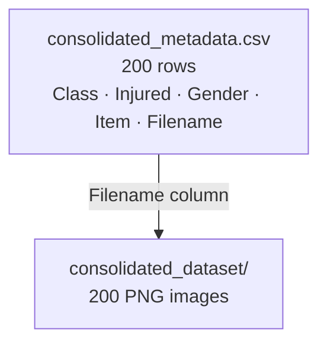

# data/

The dataset the game draws humanoids from. 200 images of humans and zombies in various states, plus a metadata CSV that maps each image to its ground-truth labels.



---

## Files in this folder

| File/Folder | What it is |
|---|---|
| `consolidated_metadata.csv` | One row per image — labels for all 200 humanoids |
| `consolidated_dataset/` | 200 PNG images referenced by the `Filename` column |

---

## consolidated_metadata.csv — the labels

Open this in a spreadsheet to browse the full dataset. Each row is one humanoid:

| Column | Example values | What it means |
|---|---|---|
| `Class` | `"Default"` or other | `"Default"` = human; anything else = zombie |
| `Injured` | `True` / `False` | Whether the humanoid is injured |
| `Gender` | `"Male"` / `"Female"` | Humanoid's apparent gender |
| `Item` | `"Bow"`, `"Hammer"`, `"None"`, ... | Item the humanoid is carrying |
| `Filename` | `consolidated_dataset/test_00000.png` | Relative path to the image |

The game reads these columns in `game_interfaces/data_parser.py` to build `Humanoid` objects each turn.

---

## How state is assigned from the CSV

`Class` and `Injured` together determine ground-truth state (`data_parser.py:103`):

| Class | Injured | State |
|---|---|---|
| `"Default"` | `False` | `healthy` |
| `"Default"` | `True` | `injured` |
| anything else | `False` | `zombie` |
| anything else | `True` | `corpse` |

To change this mapping, edit `datarow_to_state()` in `game_interfaces/data_parser.py`.

---

## Using other columns for experiments

`Gender` and `Item` are available in `datarow_to_state()` and `datarow_to_value()` but unused by default. To make triage value depend on what a humanoid is carrying:

```python
def datarow_to_value(data_row, rng=None):
    rare_items = {"Bow", "Hammer"}
    if data_row["Item"] in rare_items:
        return 0.9
    return 0.3
```

Open `consolidated_metadata.csv` first to see which item values actually appear in the dataset before writing rules based on them.
