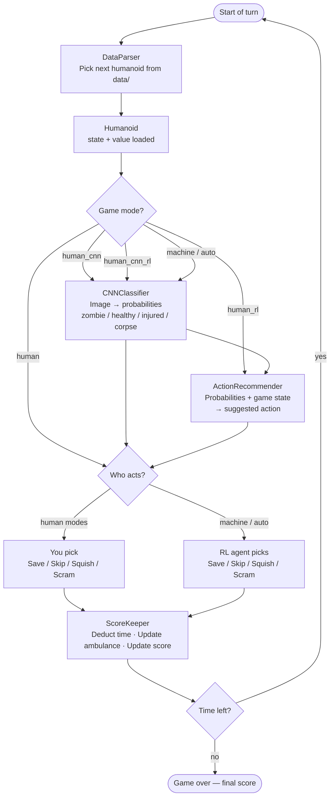

# How the Game Works — A Tour of the Codebase

Each turn, the game pulls a humanoid from the dataset, shows it to you (and optionally to a CNN or RL agent), waits for someone to choose an action — Save, Skip, Squish, or Scram — and then updates the clock and score. That loop runs until time hits zero. That's the whole game. Everything else in the codebase is in service of those four things: loading humanoids, classifying them, picking an action, and tracking what happened.

The five game modes just differ in who does the classifying and who picks the action. In `human` mode you do both. In `machine`/`auto` mode the CNN classifies and the RL agent acts. The other three modes are hybrids — the AI advises, you decide.

---

## How a Single Turn Works

**A note on the CNN path:** in `human_cnn` mode, the CNN runs but you still pick the action — the probabilities are shown as a hint. In `machine`/`auto`, the CNN output feeds directly to the RL agent and the agent acts without you.

---

## Where to Find Things

| What you want to change | File | What lives there |
|---|---|---|
| Scoring weights (how much saved vs. killed vs. value matters) | `gameplay/constants.py` | `HEADCOUNT_WEIGHT`, `VALUE_WEIGHT` |
| Scoring formula itself | `gameplay/scorekeeper.py` | `get_cumulative_reward()` — `HEADCOUNT_WEIGHT × (saved − killed) + VALUE_WEIGHT × saved_value` |
| Time per action (Save=30 min, Squish=5 min, etc.) | `gameplay/enums.py` | `ActionCost` enum |
| Total shift length, ambulance size | `gameplay/constants.py` | `SHIFT_LENGTH`, `AMBULANCE_CAPACITY` |
| Penalty for impossible actions | `gameplay/constants.py` | `BLOCKED_ACTION_PENALTY` |
| How humanoids are loaded and shuffled | `game_interfaces/data_parser.py` | `DataParser` — reads `data/consolidated_metadata.csv` |
| What a humanoid is (state, value, helper methods) | `gameplay/humanoid.py` | `Humanoid` class |
| CNN classifier | `models/CNNClassifier.py` | `classify(humanoid)` → 4 probabilities |
| RL agent recommender | `models/RLRecommender.py` | `recommend(humanoid, probs, scorekeeper)` → `ActionState` |
| Rule-based recommender (no ML) | `models/HeuristicRecommender.py` | Same interface as RLRecommender — no model weights needed |
| Time, score, ambulance tracking | `gameplay/scorekeeper.py` | `ScoreKeeper` — `save()`, `skip()`, `squish()`, `scram()` |
| The game loop and UI | `game_interfaces/base_env.py`, `ui/ui.py` | Game loop, button wiring, display |
| RL training environment | `game_interfaces/train_env.py` | `TrainEnv` — Gymnasium-compatible env used during DQN training |
| RL observation vector | `game_interfaces/obs_builder.py` | Builds the 15-number input the RL agent sees each turn |
| Model weight file paths | `gameplay/constants.py` | `CLASSIFIER_MODEL_PATH`, `RL_MODEL_PATH` |

---

## What's Fixed vs. What to Try

**Fixed — leave these alone unless you're confident:**

- The four actions (Save, Skip, Squish, Scram) and their logic in `ScoreKeeper`
- The dataset format (`data/consolidated_metadata.csv`) and how `DataParser` reads it
- The observation vector structure in `obs_builder.py` (15 slots — changing this breaks the RL model)
- The Tkinter UI wiring in `ui/ui.py`

**Good experiments to try:**

- **Scoring weights** — `HEADCOUNT_WEIGHT` and `VALUE_WEIGHT` in `constants.py`. Set `HEADCOUNT_WEIGHT = 1.0` and it only cares about raw lives saved; set it to `0.0` and it only cares about triage value. Retrain the RL agent after changing these so it learns under the new rules.
- **Action costs** — `ActionCost` in `enums.py`. Right now Squish (5 min) is much cheaper than Skip (15 min). What happens if you make them equal?
- **Game length and ambulance size** — `SHIFT_LENGTH` and `AMBULANCE_CAPACITY` in `constants.py`. Shorter shift = harder. Smaller ambulance = more Scram decisions.
- **Swap in a different recommender** — replace `RLRecommender` with `HeuristicRecommender` to test a hand-coded strategy, or write your own class with the same interface: `recommend(humanoid, probs, scorekeeper) → ActionState`.
- **Retrain the models** — `training/train_cnn.ipynb` and `training/train_rl.ipynb`. Pre-trained baselines are in `models/weights/` so you don't have to start from scratch.
