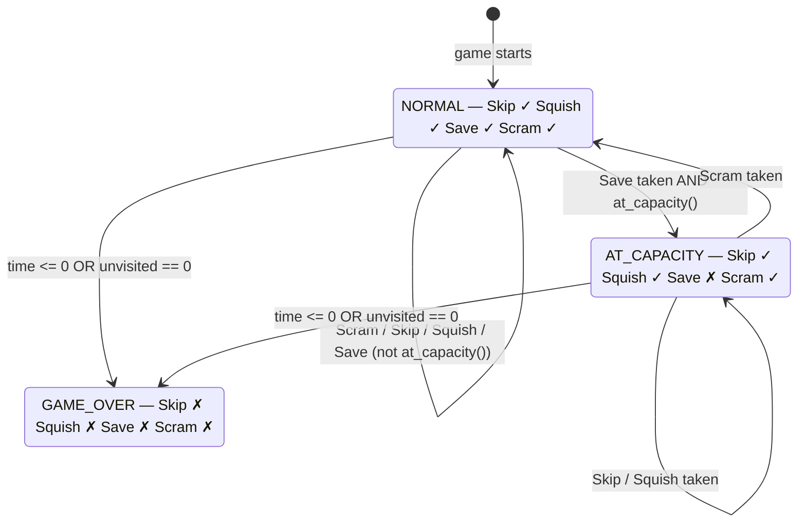
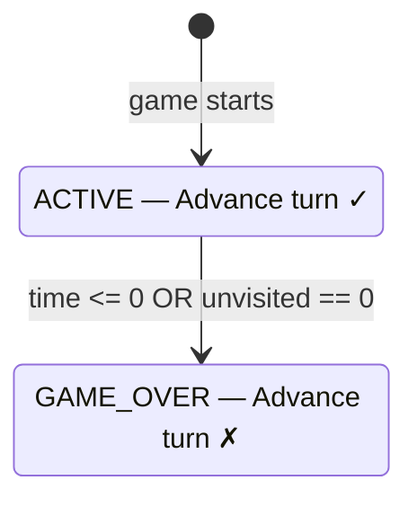

# Button Logic — Dead or Alive 2026

This document describes when each button is enabled or disabled. Two configurations exist depending on the game mode.

---

## 4-Button Mode

Used in `human`, `human_cnn`, `human_rl`, and `human_cnn_rl` modes.

### States

| State | Description |
|-------|-------------|
| NORMAL | Default. All four buttons active. |
| AT_CAPACITY | Ambulance is full — Save is disabled until Scram empties it. |
| GAME_OVER | Game has ended. All buttons disabled. |

### Transitions

**NORMAL → AT_CAPACITY:** Save is taken and the ambulance becomes full (`at_capacity()` returns true). Save is disabled until the ambulance is cleared.

**AT_CAPACITY → NORMAL:** Scram is taken. Scram always empties the ambulance, so `at_capacity()` becomes false and Save is re-enabled. Taking Scram from NORMAL has no button state effect (self-loop) — the ambulance empties all the same.

**→ GAME_OVER:** Either `remaining_time ≤ 0` (Time's Up) or `len(unvisited) == 0` (The City Is Empty). All buttons are disabled.

### Button Availability Reference

| Button | Disabled when |
|--------|--------------|
| SAVE | `remaining_time ≤ 0` OR `at_capacity()` |
| SKIP | `remaining_time ≤ 0` |
| SQUISH | `remaining_time ≤ 0` |
| SCRAM | Never disabled during active play |

---

## 1-Button Mode

Used in `machine` mode.

### States

| State | Description |
|-------|-------------|
| ACTIVE | Game is running. Advance turn button is enabled. |
| GAME_OVER | Game has ended. Advance turn is disabled. |

### Transition

**→ GAME_OVER:** Same end conditions as 4-button mode — time runs out or the city is empty. The button is disabled visually at the point the game ends.
