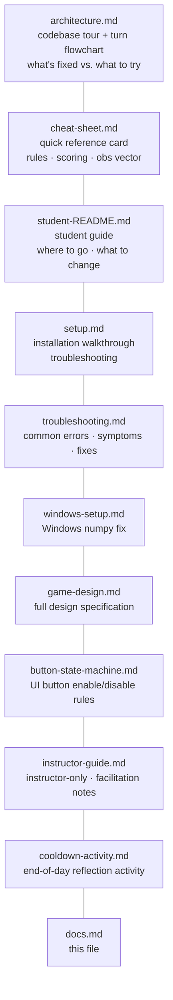

# docs/

Project documentation. Start with `architecture.md` to understand how the codebase fits together, then `student-README.md` for a guide to common experiments.

---

## Files in this folder

| File | Audience | What it contains |
|---|---|---|
| `architecture.md` | Students | How a single turn works (Mermaid flowchart), where to find things, what's fixed vs. safe to experiment with |
| `cheat-sheet.md` | Students + instructors | Quick reference card — game rules, scoring formula, RL observation vector, and extension points |
| `student-README.md` | Students | Main student guide — the five most common experiments, scoring, logging, the RL observation vector with worked examples |
| `setup.md` | Students | Step-by-step installation (tools, conda env, VS Code), running the game, opening notebooks, troubleshooting |
| `troubleshooting.md` | Students + instructors | Common errors with symptoms, causes, and fixes — safe to share directly with students |
| `windows-setup.md` | Students | One-time fix for the numpy DLL crash on Windows |
| `game-design.md` | Students + instructors | Full game design specification — rules, scoring formula, extension points, design decisions |
| `button-state-machine.md` | Instructors | Which buttons are enabled or disabled in each game state — reference for UI development |
| `instructor-guide.md` | Instructors | Facilitation notes for the 4 lecture modules, extension point guidance, quick reference |
| `cooldown-activity.md` | Students + instructors | End-of-day reflection and cooldown activity — structured debrief for closing a session |
| `docs.md` | Everyone | This file |
