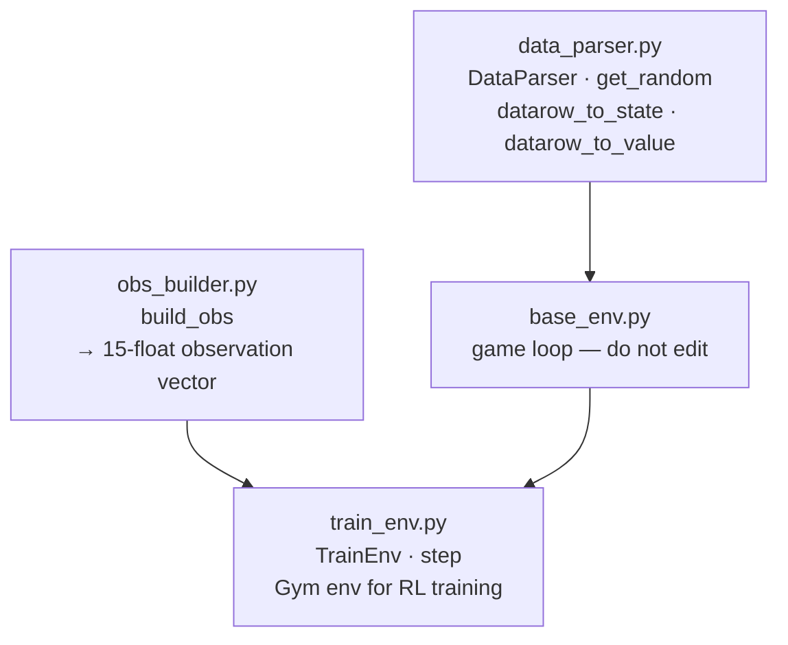

# game_interfaces/

The layer that connects the game rules to data, the UI, and the RL training loop. Two files here have extension points for experiments; the others are infrastructure you won't need to touch.



---

## Files in this module

| File | Key names | What they are |
|---|---|---|
| `data_parser.py` | `DataParser`, `.get_random()`, `datarow_to_state()`, `datarow_to_value()` | Reads the CSV and produces `Humanoid` objects each turn — two extension points here |
| `obs_builder.py` | `build_obs()` | Builds the 15-number vector the RL agent sees each turn |
| `base_env.py` | `GameEnv` | Main game loop — wires UI, data, classifier, recommender, and scorekeeper together |
| `train_env.py` | `TrainEnv`, `.step()`, `.reset()` | Gym-compatible environment used during DQN training |

---

## data_parser.py — two extension points

`DataParser` loads `data/consolidated_metadata.csv` at startup and draws humanoids one at a time without replacement. Two module-level functions at the bottom of the file are designed to be customized:

### `datarow_to_state()` — `data_parser.py:103`

Controls how a CSV row maps to a humanoid state:

| Class | Injured | State |
|---|---|---|
| `"Default"` | `False` | `healthy` |
| `"Default"` | `True` | `injured` |
| anything else | `False` | `zombie` |
| anything else | `True` | `corpse` |

To change which humanoids count as zombies, edit this function.

### `datarow_to_value()` — `data_parser.py:148`

Assigns a triage priority (0.0–1.0) to each humanoid. Default: uniform random float. To make value depend on real data:

```python
def datarow_to_value(data_row, rng=None):
    if data_row["Injured"]:
        return 0.9   # injured humans are always high priority
    return 0.3
```

Available columns: `Class`, `Injured`, `Gender`, `Item`, `Filename`. See `data/data.md` for what values are in each column.

---

## obs_builder.py — what the RL agent sees

`build_obs()` converts the current game state into the 15-number observation vector the RL agent receives each turn. You don't need to edit this unless you're adding new slots.

If you add a slot: increment `OBS_SIZE` in `gameplay/constants.py` and retrain — saved weights won't load if the vector length changes.

See `docs/student-README.md` for the full slot layout and worked examples.

---

## base_env.py and train_env.py

Leave `base_env.py` alone — it sequences turns, calls the classifier and recommender, updates the UI, and tracks score. Editing it without understanding the full flow can break game modes silently.

`train_env.py`'s `step()` method computes per-turn reward as the delta in `ScoreKeeper.get_cumulative_reward()`. If you want to change reward shaping, that's where to look — but it's usually easier to start by adjusting `HEADCOUNT_WEIGHT` and `VALUE_WEIGHT` in `gameplay/constants.py`, since the reward formula reads from those directly.
