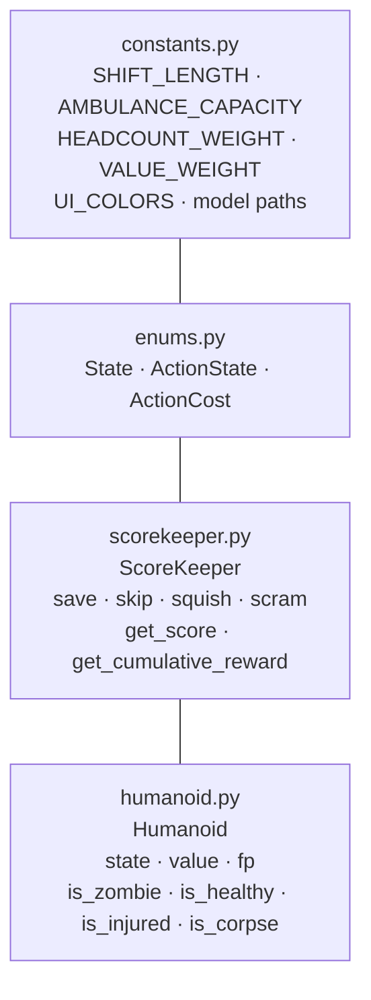

# gameplay/

The core rules layer. This is where the game's math lives — scoring weights, action costs, shift length, and what each humanoid state means. Most experiments start here.



---

## Files in this module

| File | Key names | What they are |
|---|---|---|
| `constants.py` | `SHIFT_LENGTH`, `AMBULANCE_CAPACITY`, `HEADCOUNT_WEIGHT`, `VALUE_WEIGHT`, `UI_COLORS`, `CLASSIFIER_MODEL_PATH`, `RL_MODEL_PATH` | Game-wide constants — the most common starting point for experiments |
| `enums.py` | `State`, `ActionState`, `ActionCost` | Defines the four humanoid states and four actions with their time costs |
| `scorekeeper.py` | `ScoreKeeper`, `.save()`, `.skip()`, `.squish()`, `.scram()`, `.get_score()`, `.get_cumulative_reward()` | Tracks everything during a game — time, ambulance, kills, saves |
| `humanoid.py` | `Humanoid`, `.state`, `.value`, `.fp`, `.is_zombie()`, `.is_healthy()`, `.is_injured()`, `.is_corpse()` | Data class for a single humanoid |

---

## constants.py — the most common starting point

Open this file when you want to adjust game-wide numbers. Changes take effect on the next run — no retraining needed (except where noted).

| Constant | Default | What it does |
|---|---|---|
| `SHIFT_LENGTH` | `720` | Total game time in minutes |
| `AMBULANCE_CAPACITY` | `10` | How many humanoids fit on the ambulance at once |
| `HEADCOUNT_WEIGHT` | `0.5` | Weight on (saved − killed) in the scoring formula |
| `VALUE_WEIGHT` | auto | Set automatically to `1.0 - HEADCOUNT_WEIGHT` — don't edit directly |
| `CLASSIFIER_MODEL_PATH` | `models/weights/baselineCNN.pth` | Where the CNN loads its weights from |
| `RL_MODEL_PATH` | `models/weights/baselineRL.pth` | Where the RL agent loads its weights from |
| `LEGACY_CLOCK` | `True` | `True` = analog clock, `False` = digital countdown |
| `UI_COLORS` | dict | Hex color strings for every UI element |

After changing `HEADCOUNT_WEIGHT`, retrain the RL agent — its weights were learned under the old formula.

---

## enums.py — actions and their costs

```python
class ActionCost(Enum):
    SAVE   = 30   # minutes
    SQUISH = 5
    SKIP   = 15
    SCRAM  = 120
```

Squish (5 min) is cheaper than Skip (15 min) by design — the agent has to learn that squishing is faster even when it kills. Changing these costs changes the trade-off the agent faces. Retrain after any change.

**Keep in sync:** `ActionState` and `ActionCost` must always have the same four members. If you add an action to one, add it to both.

---

## scorekeeper.py — what gets tracked

| What | How to access |
|---|---|
| Minutes left in the shift | `sk.remaining_time` |
| Max ambulance capacity | `sk.capacity` |
| Passengers on board right now | `sk.ambulance` → `{"zombie": 0, "healthy": 3, "injured": 1, "corpse": 0}` |
| Final score | `sk.get_score()` → `{"killed": 2, "saved": 5, "saved_value": 3.1}` |

`get_score()` scrams anyone still on the ambulance before returning — the result is always the complete final tally.

The scoring formula (`scorekeeper.py:440`):

```
HEADCOUNT_WEIGHT × (saved − killed) + VALUE_WEIGHT × saved_value
```

Both weights come from `gameplay/constants.py`.

---

## humanoid.py — a single humanoid

Each turn, `DataParser` creates a `Humanoid` with three attributes:

| Attribute | What it is |
|---|---|
| `humanoid.state` | Ground truth: `"zombie"`, `"healthy"`, `"injured"`, or `"corpse"` |
| `humanoid.fp` | Relative path to the image file |
| `humanoid.value` | Triage priority, 0.0–1.0 (assigned by `DataParser`) |

You won't edit this file. Triage value is assigned in `datarow_to_value()` in `game_interfaces/data_parser.py`.
