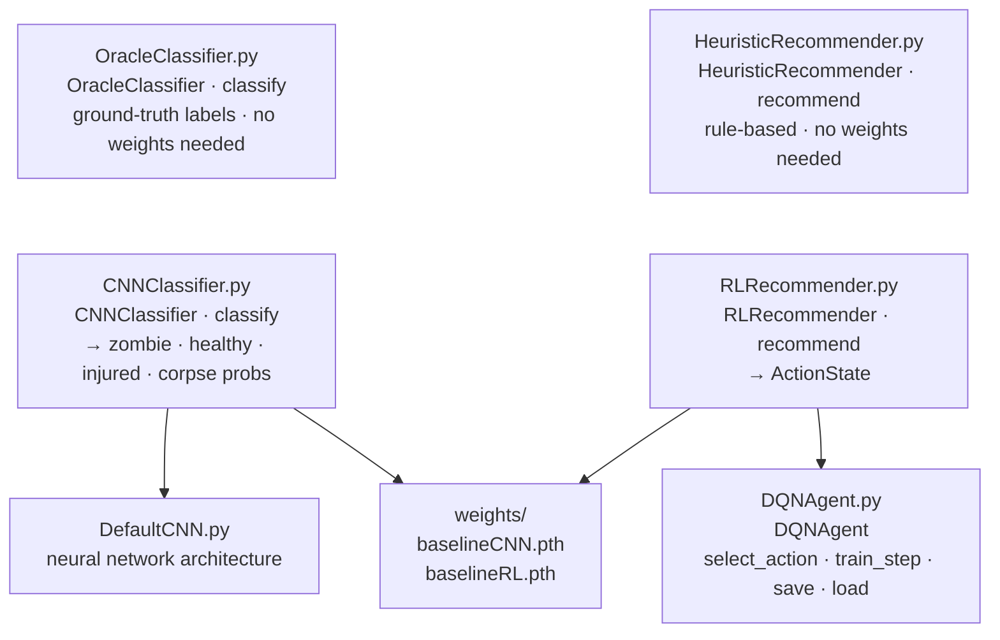

# models/

The two AI components: a CNN that classifies humanoid images, and an RL agent that picks actions. There's also a rule-based alternative that requires no trained weights and is easy to modify.



---

## Files in this module

| File | Key names | What they are |
|---|---|---|
| `CNNClassifier.py` | `CNNClassifier`, `.classify()` | Loads trained weights; classifies a humanoid image → 4 probabilities |
| `OracleClassifier.py` | `OracleClassifier`, `.classify()` | Uses ground-truth labels directly — perfect classifier, no weights needed |
| `RLRecommender.py` | `RLRecommender`, `.recommend()` | Loads trained RL weights; recommends an action |
| `HeuristicRecommender.py` | `HeuristicRecommender`, `.recommend()` | Rule-based recommender — no weights, easy to edit |
| `HumanoidClassifier.py` | `HumanoidClassifier` (ABC) | Defines the classifier contract — all classifiers implement `.classify()` |
| `ActionRecommender.py` | `ActionRecommender` (ABC) | Defines the recommender contract — all recommenders implement `.recommend()` |
| `DefaultCNN.py` | `DefaultCNN` | CNN architecture used by `CNNClassifier` |
| `DQNAgent.py` | `DQNAgent`, `.select_action()`, `.train_step()`, `.save()`, `.load()` | DQN agent — policy network, target network, replay buffer |
| `DQN.py` | `DQN` | Neural network used inside `DQNAgent` |
| `weights/` | `baselineCNN.pth`, `baselineRL.pth` | Saved model files |

---

## CNNClassifier — image → probabilities

`classify(humanoid)` reads the humanoid's image and returns a 4-float array:

```python
probs = classifier.classify(humanoid)
# probs[0] = zombie probability
# probs[1] = healthy probability
# probs[2] = injured probability
# probs[3] = corpse probability
```

Weights load from `models/weights/baselineCNN.pth` (path set in `gameplay/constants.py`). If the file is missing, you'll get a `FileNotFoundError` at startup — train first:

```
python main.py train --type cnn
```

---

## OracleClassifier — perfect classifier, no weights needed

Same interface as `CNNClassifier`, but reads the humanoid's ground-truth state directly instead of running a CNN. Returns a perfect one-hot array:

```python
probs = classifier.classify(humanoid)
# e.g. [1., 0., 0., 0.] if the humanoid is a zombie — always correct
```

Use it to isolate whether a problem is in the perception model or the RL policy. If the game plays well with `OracleClassifier` but poorly with `CNNClassifier`, the CNN is the bottleneck. If it plays poorly with both, the RL policy itself needs work. To swap it in, replace `CNNClassifier` with `OracleClassifier` in `main.py` (`_make_components()` and `_run_auto()`).

---

## RLRecommender — trained action picker

`recommend(humanoid, probs, scorekeeper)` returns an action:

```python
action = recommender.recommend(humanoid, probs, scorekeeper)
# action: ActionState.SAVE | SKIP | SQUISH | SCRAM
```

Weights load from `models/weights/baselineRL.pth`. Train first if missing:

```
python main.py train --type rl
```

To change agent behavior, tune hyperparameters in `training/train_rl.py` and retrain. See `training/training.md`.

---

## HeuristicRecommender — rule-based, no weights needed

Same interface as `RLRecommender`. Decision rules:

- Ambulance full or no time left → scram
- CNN predicts zombie or corpse → squish
- CNN predicts healthy or injured → save

Use this to test whether hand-coded rules beat the trained agent, or as a starting point for writing your own strategy. To swap it in, replace `RLRecommender` with `HeuristicRecommender` in `main.py` (`_make_components()` and `_run_auto()`).

---

## Writing your own classifier

Any class that implements this method signature can replace `CNNClassifier` or `OracleClassifier`:

```python
def classify(self, humanoid: Humanoid) -> np.ndarray:
    ...
```

The method must return a 4-float array of probabilities (summing to 1.0) in class order: `[zombie, healthy, injured, corpse]`. Inherit from `HumanoidClassifier` (`models/HumanoidClassifier.py`) and implement `classify()`. Swap it in wherever `CNNClassifier` is instantiated in `main.py` (`_make_components()` and `_run_auto()`).

---

## Writing your own recommender

Any class that implements this method signature can replace either recommender:

```python
def recommend(self, humanoid: Humanoid, probs: np.ndarray, scorekeeper: ScoreKeeper) -> ActionState:
    ...
```

Inherit from `ActionRecommender` (`models/ActionRecommender.py`) and implement `recommend()`. The method receives the current humanoid, the CNN's 4-float probability array, and the `ScoreKeeper` — everything you need to make a decision.
