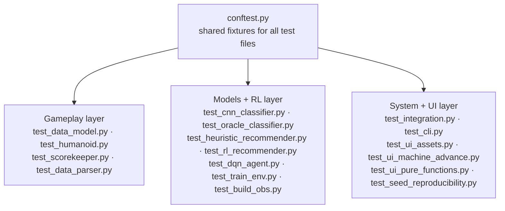

# tests/

The automated test suite. 293 tests covering game logic, models, RL environment, and UI components. Run with:

```
pytest
```



---

## What each file tests

| File | What it covers |
|---|---|
| `conftest.py` | Shared fixtures available to all test files |
| `test_data_model.py` | Enum ordering and `ActionCost` values — pins the contracts the RL obs space and scoring depend on |
| `test_humanoid.py` | `Humanoid` construction, state predicate methods, index/string converters |
| `test_scorekeeper.py` | Scoring math — save, squish, skip, scram, capacity, available actions, cumulative reward, `get_score()` side effects |
| `test_data_parser.py` | CSV loading, `get_random()`, pool exhaustion, `reset()`, `datarow_to_state()` / `datarow_to_value()` |
| `test_cnn_classifier.py` | `classify()` output shape, probability range, softmax sum |
| `test_oracle_classifier.py` | `OracleClassifier` — deterministic state-to-one-hot mapping for all four states |
| `test_heuristic_recommender.py` | `recommend()` — all state × capacity combinations |
| `test_rl_recommender.py` | All 15 observation slots — range, one-hot encoding, time binning |
| `test_dqn_agent.py` | `DQNAgent` construction, `select_action()`, `train_step()`, `save()`/`load()` round-trip |
| `test_train_env.py` | `TrainEnv.step()` — blocked actions, terminal step, obs shape/range, reward delta |
| `test_build_obs.py` | `build_obs()` — verifies `TrainEnv` and `RLRecommender` produce identical observations |
| `test_integration.py` | End-to-end episode loop with each classifier/recommender combination |
| `test_cli.py` | `main.py` argument parsing — all modes, flags, invalid inputs |
| `test_ui_assets.py` | UI asset presence — logo and graphics files at expected paths |
| `test_ui_machine_advance.py` | Machine-mode advance button behavior |
| `test_ui_pure_functions.py` | Pure UI helper functions — no Tkinter window required |
| `test_seed_reproducibility.py` | Same seed produces identical humanoid sequences across runs |

---

## Adding your own tests

1. Create `tests/test_<your_thing>.py`
2. Name functions `test_<what>_<expected_outcome>`
3. Use fixtures from `conftest.py`, or define your own in the same file
4. Run `pytest` — new files are picked up automatically

```python
def test_scorekeeper_save_reduces_remaining_time():
    from gameplay.scorekeeper import ScoreKeeper
    from gameplay.humanoid import Humanoid
    sk = ScoreKeeper(shift_length=720, capacity=10)
    h = Humanoid(fp="x.jpg", state="healthy")
    sk.save(h)
    assert sk.remaining_time == 720 - 30  # SAVE costs 30 minutes
```
