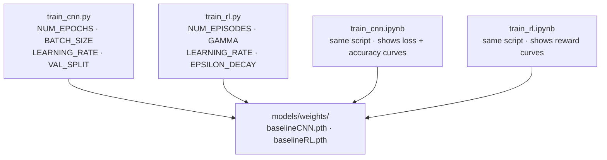

# training/

Scripts and notebooks for training the CNN and RL agent. Notebooks are easier for experimenting interactively; scripts are faster for a quick retrain from the terminal.



---

## Files in this module

| File | Key names | What they are |
|---|---|---|
| `train_cnn.py` | `NUM_EPOCHS`, `BATCH_SIZE`, `LEARNING_RATE`, `VAL_SPLIT`, `train()` | CNN training script — saves weights to `models/weights/baselineCNN.pth` |
| `train_rl.py` | `NUM_EPISODES`, `GAMMA`, `LEARNING_RATE`, `EPSILON_DECAY`, `train()` | RL training script — saves weights to `models/weights/baselineRL.pth` |
| `train_cnn.ipynb` | same as script | Notebook version with live loss and accuracy curves |
| `train_rl.ipynb` | same as script | Notebook version with live reward curves per episode |

---

## How to train

```
python main.py train --type cnn
python main.py train --type rl
```

Or open the notebooks in JupyterLab and run cell by cell. Pre-trained baselines are already in `models/weights/` — you don't have to start from scratch.

---

## CNN hyperparameters — `train_cnn.py:61`

```python
NUM_EPOCHS     = 10      # training passes over the full dataset
BATCH_SIZE     = 8       # images per gradient update
LEARNING_RATE  = 0.001   # Adam optimizer step size
VAL_SPLIT      = 0.2     # fraction of data held out for validation
```

On this dataset (160 training images after the split), overfitting typically sets in around 15–20 epochs — training accuracy keeps rising while validation accuracy peaks and drops. Watch the curves in the notebook.

---

## RL hyperparameters — `train_rl.py:75`

```python
NUM_EPISODES    = 2500   # game episodes to train on
BATCH_SIZE      = 32     # transitions per gradient update
GAMMA           = 0.99   # discount factor — how much future rewards matter
LEARNING_RATE   = 1e-3   # Adam step size
EPSILON_DECAY   = 1250   # episodes over which exploration decays
```

**GAMMA** controls planning horizon: `0.99` means the agent values future rewards nearly as much as immediate ones. Lower values (e.g. `0.9`) make it more short-sighted.

**Reward shaping:** the per-turn reward is the delta in `ScoreKeeper.get_cumulative_reward()`, computed in `game_interfaces/train_env.py`'s `step()`. The formula reads `HEADCOUNT_WEIGHT` and `VALUE_WEIGHT` from `gameplay/constants.py` — change those and retrain to shift the agent's priorities.

---

## Where weights are saved

| Model | Path |
|---|---|
| CNN | `models/weights/baselineCNN.pth` |
| RL | `models/weights/baselineRL.pth` |

Paths are set in `gameplay/constants.py` as `CLASSIFIER_MODEL_PATH` and `RL_MODEL_PATH`. Change them there to point to a different weights file without overwriting the baseline.
