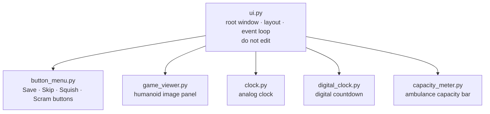

# ui/

Everything you see on screen. The parts you're most likely to want to change are controlled by constants in `gameplay/constants.py` — you usually don't need to touch UI files directly.



---

## Files in this module

| File | Key names | What they are |
|---|---|---|
| `ui.py` | `UI` | Root window, game layout, main display loop — the backbone |
| `button_menu.py` | `ButtonMenu` | The four action buttons and their state management |
| `game_viewer.py` | `GameViewer` | The humanoid image display panel |
| `clock.py` | `Clock` | Analog clock (default when `LEGACY_CLOCK = True`) |
| `digital_clock.py` | `DigitalClock` | Digital countdown (used when `LEGACY_CLOCK = False`) |
| `capacity_meter.py` | `CapacityMeter` | The ambulance occupancy bar |

---

## Colors — edit in constants.py

All UI colors are defined in `UI_COLORS` in `gameplay/constants.py`:

```python
UI_COLORS: dict[str, str] = {
    "bg": "#1a1a1a",          # window and canvas background
    "panel": "#242424",       # widget panel backgrounds
    "fg": "#f0f0f0",          # default text
    "btn_save": "#1e4d35",    # Save button
    "btn_skip": "#2e4057",    # Skip button
    "btn_squish": "#7b2d2d",  # Squish button
    "btn_scram": "#6b4c11",   # Scram button
    "meter_filled": "#e63946",# filled ambulance slots
    "accent": "#e63946",      # highlights and end-screen text
}
```

Change any hex string and restart the game to see the result. No other files need to change.

---

## Clock style — one flag in constants.py

```python
LEGACY_CLOCK: bool = True   # True = analog, False = digital countdown
```

---

## What not to touch

`ui.py` wires the entire display together and manages the Tkinter event loop. It is the most complex file in the project. Unless you're adding a new UI component, leave it alone — bugs here can make the game unrunnable in ways that are hard to diagnose.

To experiment with game behavior, start with `gameplay/constants.py`, `gameplay/enums.py`, or `game_interfaces/data_parser.py`.
